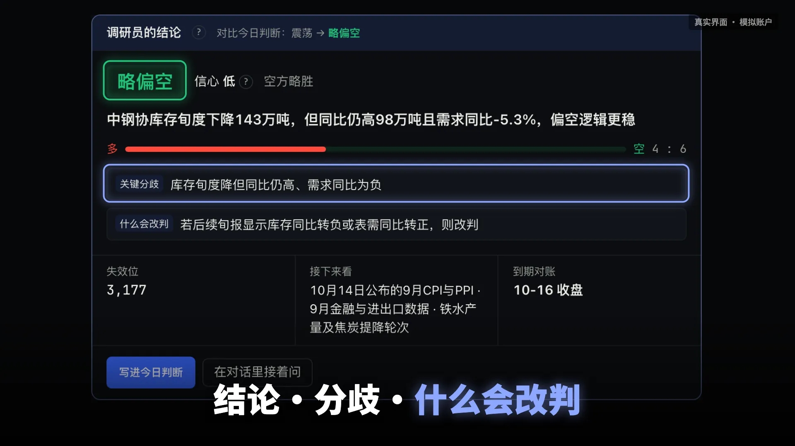
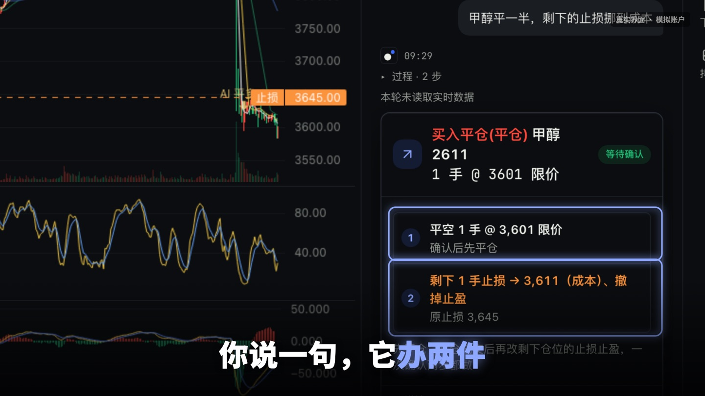
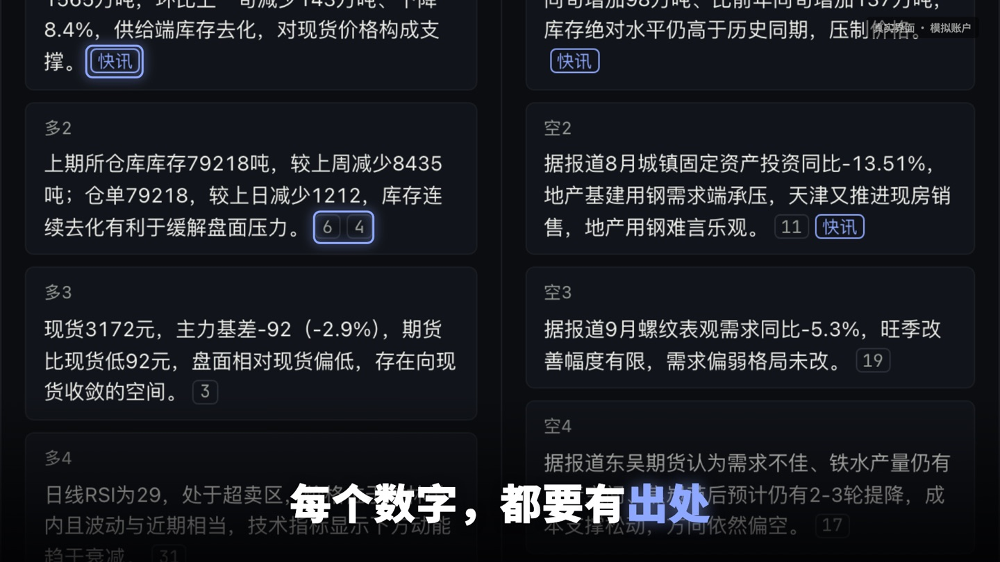
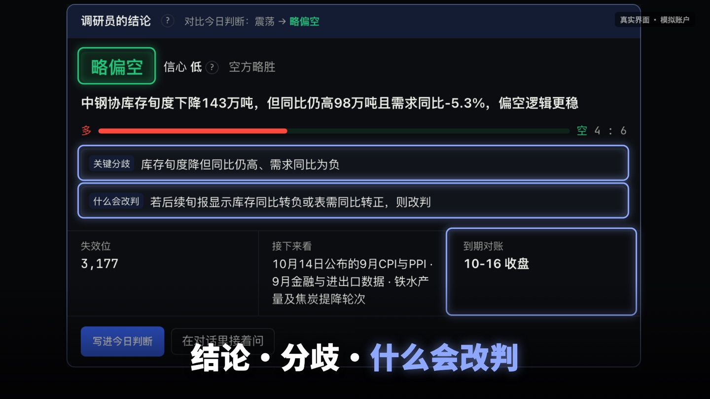
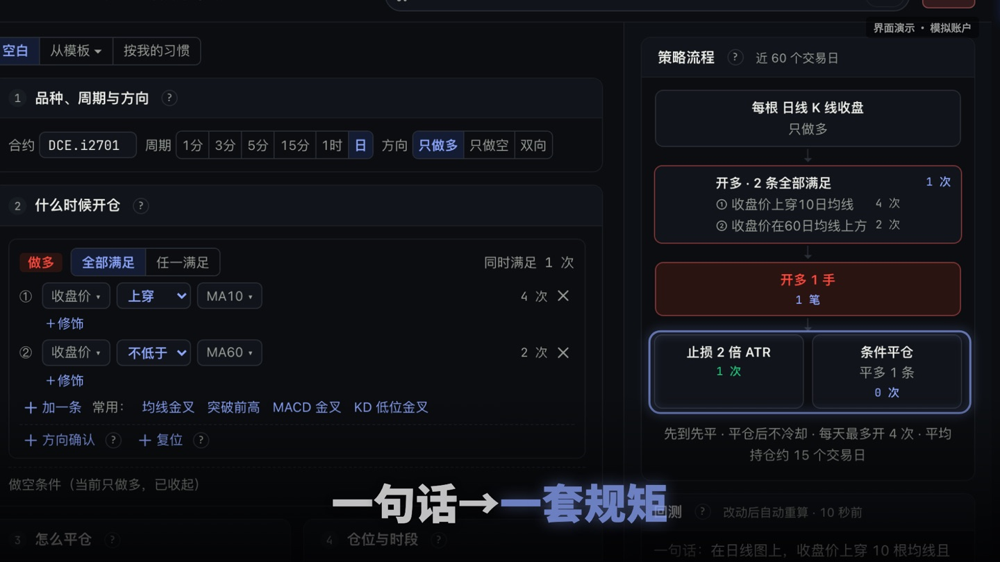
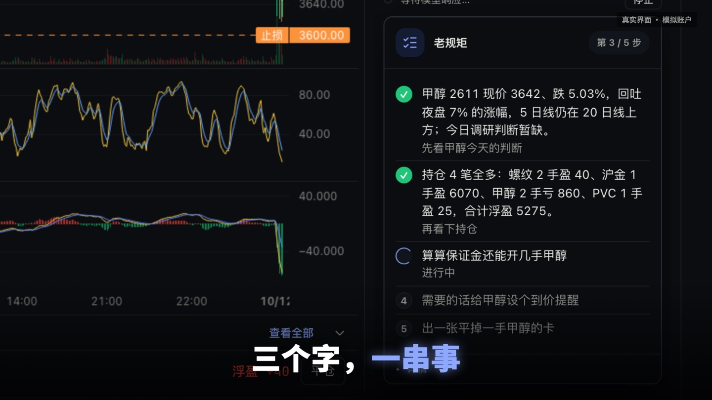
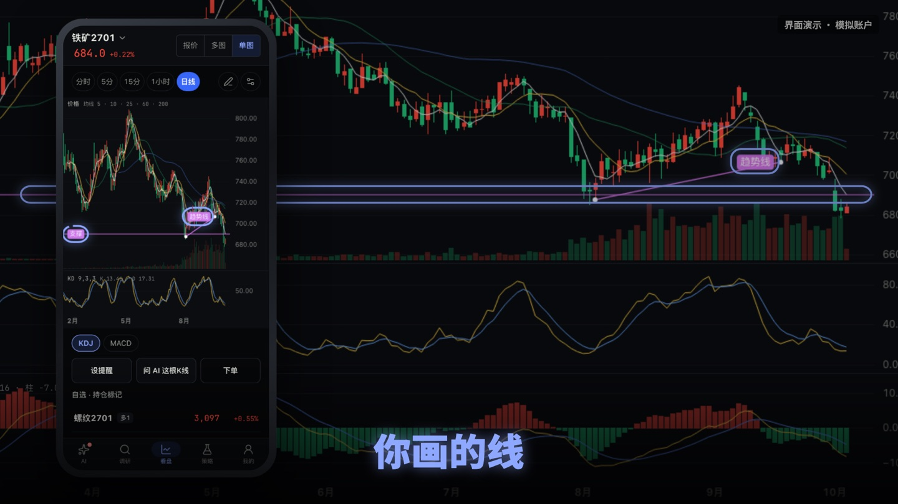

<p align="center">
  
</p>

<h1 align="center">Sente 弈先 · AI 私人交易助理</h1>

<p align="center">
  <b>一个人，一支交易团队。</b><br>
  一个 AI 看多，一个 AI 看空，吵完再给你结论。盯盘、研究、下单、复盘，交给你自己的 AI 交易助理。
</p>

<p align="center">
  <a href="https://github.com/kingcharleslzy-ai/sentetrader/releases/latest"><b>下载最新版</b></a> ·
  <a href="https://qilinshuzhi.com/trader/download">官网</a> ·
  <a href="https://qilinshuzhi.com/trader/">网页版</a> ·
  注册邀请码 <code>sente</code>
</p>

---

## 它一天替你干的 5 件事

| | |
|---|---|
| **01 替你读新闻** | 交易所、部委、外电、SMM、Mysteel 的快讯它先读一遍，英文当场翻成中文，和你无关的直接筛掉。 |
| **02 替你跑腿** | 说一句「甲醇平一半，剩下的止损挪到成本」，它拆成两步出一张确认卡，你点头才下单。 |
| **03 替你吵架** | 让两个 AI 分别站多方和空方，各自拿资料辩论，没出处的数字当场判不通过，吵完由裁判给出结论、分歧和改判条件。 |
| **04 替你写策略** | 随口一句交易想法，变成一条条规则和流程图；你画的支撑线也能写进规则，先拿历史行情回测撞一遍墙。 |
| **05 比你更懂你** | 收盘后陪你复盘每一笔是计划内还是临时起意，记住你的交易习惯和你定过的规矩。 |

<p align="center">
  
  
  
  
  
  
</p>

## 下载与安装

到 [Releases](https://github.com/kingcharleslzy-ai/sentetrader/releases/latest) 下载对应安装包。每次正式发布都会自动同步到这里，和官网是同一份文件，可以用 `SHA256SUMS` 核对。

| 系统 | 安装包 |
|---|---|
| macOS 13 及以上（Apple 芯片） | `AI-Trader_<版本>_aarch64.dmg` |
| Windows 10 / 11（x64） | `AI-Trader_<版本>_x64-setup.exe` |

- macOS 版已经过 Apple 签名和公证。Windows 版没有商业代码签名，第一次打开时系统可能弹出安全提示，选「仍要运行」即可。
- 装好后软件会自动更新。
- 不想安装也可以直接用[网页版](https://qilinshuzhi.com/trader/)。

## 注册

首次登录填写邀请码 **`sente`**。

## 从源码运行

需要 Node 22、npm 10、Python 3.12 和 [uv](https://docs.astral.sh/uv/)；桌面版另需 Rust 和 Tauri 2 的平台工具链。

```bash
npm ci
uv sync --frozen --python 3.12 --project services/trader-runtime
npm run dev
```

浏览器打开 `http://127.0.0.1:5173`，本机服务在 `http://127.0.0.1:8000`，用内置演示数据运行；设 `AI_TRADER_AGENT_MODE=fake` 可不配模型离线体验。用你自己的模型密钥和快期账号、完全不连我们服务器的本机版正在做。实盘交易始终关闭。

```text
apps/client/                 网页与桌面共用的界面（React + Vite）
apps/desktop/                桌面壳（Tauri 2）、命令行与 MCP
services/trader-runtime/     本机/云端服务：模型、策略、回测、模拟交易
services/tqkq-sidecar/       快期行情、模拟撮合与回放
services/mt5-bridge/         外盘只读行情桥（可选）
packages/ui-events/          前后端共用的事件契约
skills/ai-trader/            外部 AI 操作指南（MCP / CLI）
docs/                        架构与功能说明
```

## 关于这个仓库

代码从开发仓库自动同步过来，每次修复合并后都会出现在这里；官网 Sente 页的静态快照在 [`docs/index.html`](docs/index.html)（以[官网](https://qilinshuzhi.com/trader/download)为准），各版本安装包在 Releases。

问题与建议欢迎提 [Issue](https://github.com/kingcharleslzy-ai/sentetrader/issues)，或写信 lzy619202200@163.com。

## 许可证

[GNU AGPL-3.0](LICENSE)，Copyright (C) 2026 杭州富阳启临数智科技工作室。可以自由使用、修改和分发；把修改后的版本作为网络服务提供给别人时，须按 AGPL 公开对应源码。第三方组件见 [THIRD_PARTY_NOTICES.md](THIRD_PARTY_NOTICES.md)。

## 风险提示

Sente 当前面向模拟交易账户，界面截图来自模拟账户。软件中的分析、研讨结论和回测结果均不构成投资建议，回测不代表未来表现。期货交易有风险，入市需谨慎。
